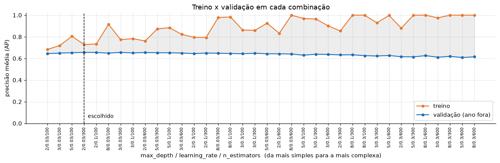
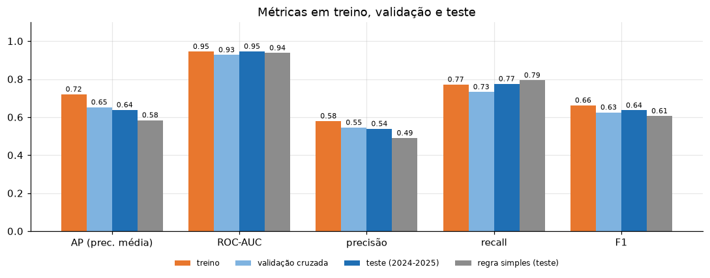

# AlagaAlerta: relatório de Machine Learning

**GS 2026.2 CitizenTech · Inteligência Artificial & Machine Learning · Engenharia de Software, 3º ano**

| Integrante | RM |
|---|---|
| Renato Luiz Cordão | 556403 |
| Vitor Victorino Couto | 554965 |
| Victoria Moura | 555474 |
| Fabricio Bettarello | 554638 |
| Enzo Miletta | 98677 |

Notebook: [`alagaalerta_ml.ipynb`](alagaalerta_ml.ipynb) · Dados: [`dados/README.md`](dados/README.md)

---

## 1. Problema e pergunta de ML

Em São Paulo, quem mora ou passa por uma rua que alaga costuma descobrir tarde demais, com a água já na porta ou o carro preso. O AlagaAlerta junta um sensor ultrassônico no ESP32 em bueiros e córregos, um backend que gera alertas por bairro e um app em que o morador vê os pontos de risco e relata alagamentos. A parte de ML responde:

> **Sabendo quanto choveu, e com que intensidade, nas estações do INMET em São Paulo, qual a probabilidade de o CGE registrar pelo menos um ponto de alagamento em cada região da cidade naquele dia?**

É uma classificação binária. Cada linha é um par (dia, região), e o alvo vale 1 se a região alagou. A probabilidade vira o nível de aviso do app.

## 2. Dados reais e públicos

| | INMET | CGE (Prefeitura de SP) |
|---|---|---|
| Conteúdo | chuva, temperatura e umidade de hora em hora | pontos de alagamento: dia, região, subprefeitura, horário, endereço |
| Link | portal.inmet.gov.br/dadoshistoricos | cgesp.org/v3/alagamentos.jsp |
| Período | 01/01/2019 a 31/12/2025 | 01/01/2019 a 31/12/2025 |
| Volume | estações A701 (Mirante) e A771 (Interlagos), 61.368 horas cada | 2.557 dias consultados, 5.647 pontos em 597 dias |
| Coleta | `coleta/baixar_inmet.py` | `coleta/coletar_cge.py` (o CGE não tem API, então o script lê a página dia por dia) |

O recorte começa em 2019 porque a estação de Interlagos começou a operar em 2018. O script do CGE confere se a quantidade de pontos lida bate com o total que o site mostra, e bateu nos 2.557 dias. Não há dado simulado nem dado pessoal.

## 3. Escolha do modelo: XGBoost

São 20 variáveis numéricas em tabela, formato em que árvores costumam ser o melhor ponto de partida. A relação entre chuva e alagamento não é linear: 10 mm espalhados no dia não fazem nada, enquanto 40 mm em uma hora param a Marginal, e a árvore aprende esses pontos de virada sozinha. O XGBoost também aceita valor faltando quando uma estação para de medir e permite controlar o overfitting por `learning_rate` e `n_estimators`.

Ficaram de fora o KMeans + PCA, que é não supervisionado, quando nós temos o rótulo; a LSTM, que pede sequências longas e muito mais que ~2.500 dias; e o MLP, que costuma perder para árvore em tabela pequena. O Random Forest era a alternativa mais próxima, mas no boosting cada árvore corrige os erros das anteriores, o que ajuda com a classe rara (11% das linhas). Como referência, comparamos com a regra *"alerta se alguma estação marcar 12 mm ou mais"*, com o limite escolhido no treino.

## 4. Preparação e divisão treino/teste

- **Estação de Barueri (A755) descartada**: ficou sem medir chuva em 95% das horas de 2021 e 89% de 2024, que é ano de teste.
- **Umidade de Interlagos descartada**: o sensor ficou travado em 100% em 39,7% das horas de 2022 (e 32,3% em 2023), um defeito que só existe no treino.
- **Fuso horário**: o INMET mede em UTC e o CGE registra no horário de Brasília. Tudo foi convertido para `America/Sao_Paulo` antes de somar por dia. Sem isso, o temporal das 21h cairia no dia seguinte.
- **Faltas**: `-9999` vira valor faltando, e dia com menos de 20 horas medidas fica sem chuva em vez de ganhar um total errado.
- **Extremos conferidos**: o pico de 82 mm em 1 hora (Mirante, 24/01/2025) bate com os 39 alagamentos que o CGE registrou nesse dia, então ficou.

**Variáveis por dia:** chuva total, maior chuva em 1 h e em 3 h seguidas, temperatura máxima e umidade de cada estação; a maior chuva entre as duas; chuva de 1, 3 e 7 dias antes; mês; região (0/1). A tabela tem **15.336 linhas** (dia × 6 regiões), 11,2% com alagamento.

**Divisão por tempo:** o treino vai de 2019 a 2023 (10.956 linhas) e o teste fica com 2024 e 2025 (4.380). Um temporal dura dois ou três dias e as 6 regiões do mesmo dia compartilham a chuva. Num sorteio, o modelo veria a quinta-feira no treino e seria testado na sexta do mesmo temporal.

## 5. Treino com diferentes hiperparâmetros

Foram **36 combinações** de `max_depth` (2, 3, 5, 8), `learning_rate` (0.03, 0.1, 0.3) e `n_estimators` (100, 300, 600). A **validação cruzada foi só no treino e por ano** (`GroupKFold`): treina com 4 anos e valida no quinto. A métrica é a **precisão média (AP)**. A acurácia não serve, porque dizer "não alaga" sempre já daria 89%.

| # | max_depth | learning_rate | n_estimators | AP treino | AP validação | diferença |
|---|---|---|---|---|---|---|
| 1 | 2 | 0.03 | 300 | 0,728 | **0,656** | 0,07 |
| 2 | 3 | 0.03 | 300 | 0,774 | 0,656 | 0,12 |
| 3 | 2 | 0.1 | 100 | 0,734 | 0,655 | 0,08 |
| 24 | 8 | 0.1 | 300 | 1,000 | 0,634 | 0,37 |
| 36 | 5 | 0.3 | 600 | 1,000 | 0,608 | 0,39 |

*(as 36 combinações estão no notebook e em `figuras/busca_hiperparametros.csv`)*

Árvores rasas com aprendizado lento ficaram no topo, e `learning_rate = 0.3` aparece em 9 das 12 piores. As 10 primeiras ficam entre 0,656 e 0,650, menos que a variação entre anos (desvio ~0,06). A escolhida é das mais simples e a que menos decora o treino. O limiar de alerta (**0,29**) foi escolhido maximizando o F1 nas previsões "fora da dobra" do treino, sem olhar o teste.

## 6. Resultados em treino e teste

| Métrica | Treino | Validação cruzada | **Teste 2024-25** | Regra 12 mm (teste) |
|---|---|---|---|---|
| AP | 0,720 | 0,652 | **0,638** | 0,584 |
| ROC-AUC | 0,945 | 0,927 | **0,946** | 0,938 |
| Precisão | 0,579 | 0,545 | **0,539** | 0,490 |
| Recall | 0,772 | 0,733 | **0,775** | 0,794 |
| F1 | 0,662 | 0,625 | **0,636** | 0,606 |

**Overfitting.** Na busca, os modelos complexos chegaram a AP 1,0 no treino e só ~0,61 na validação, porque decoraram os temporais passados. O modelo escolhido vai de 0,72 no treino para 0,64 no teste, e a validação por ano (0,65) previu bem o teste. Parte da queda vem de 2024-25 terem tido menos alagamentos (9,6% contra 11,9%). Um chute daria AP 0,096.

**Contra a regra.** O modelo avisou 327 dos 422 alagamentos do teste e a regra 335, quase o mesmo, mas com **280 alarmes falsos contra 349**, 20% a menos. O ganho está em avisar melhor, não em avisar mais.

**Limite.** O recall por região vai de 67% a 85%, mas a precisão cai para 37% na Zona Sul: quando chove forte em Interlagos, o modelo avisa várias regiões ao mesmo tempo. Dos 95 alagamentos sem aviso, 42 aconteceram em dias em que nenhuma estação passou de 5 mm, porque a chuva caiu longe dos pluviômetros.

## 7. Conclusão: o que isso significa para o morador

| Nível no app | Região alagou de fato | Parcela dos alagamentos de 2024-25 |
|---|---|---|
| **Alerta** (≥ 50%) | 65% das vezes | 56% |
| **Atenção** (29% a 50%) | 37% das vezes | 22% |
| **Normal** | 2,5% das vezes | 22% |

**Alerta** quer dizer que, em 2 de cada 3 vezes, a região alaga: é hora de evitar a rua que costuma encher e tirar o carro de lugar baixo. **Atenção** é ficar de olho. No **normal**, que é a grande maioria dos dias, quase nunca alaga. O aviso aparece em cerca de 14% dos dias de cada região, quase todos no verão, e isso importa, porque alerta que toca demais acaba desativado. Os nomes são os mesmos que o CGE já usa nos comunicados à população.

O modelo responde bem **se** vai alagar, e erra menos que a regra dos 12 mm. Ele não responde **onde**, porque enxerga dois pontos de chuva numa cidade de 1.500 km². Esse é o papel do resto do AlagaAlerta: o sensor ultrassônico no bueiro (o mesmo princípio que a rede telemétrica do SAISP usa nos rios de SP) e o relato do morador mostram em qual rua a água está subindo.

**Limitações e próximos passos:** (1) o modelo usa a chuva medida no dia, e para avisar com antecedência o app precisa receber a **previsão** de chuva; (2) a base do CGE pende para vias grandes, com 57% de avenidas e só 25% de ruas; (3) incluir os pluviômetros do CGE e do Cemaden e, quando houver histórico, o nível medido pelos sensores do projeto.

**ODS:** 11 (meta 11.5, reduzir pessoas afetadas por desastres ligados à água) e 13 (meta 13.1, adaptação a eventos climáticos extremos).

---

**Fontes:** INMET, dados históricos: https://portal.inmet.gov.br/dadoshistoricos · CGE, alagamentos: https://www.cgesp.org/v3/alagamentos.jsp · classificação dos pontos: https://www.cgesp.org/v3/alagamentos-classificacao.jsp · monitoramento: https://www.cgesp.org/v3/monitoramento.jsp · bibliotecas: pandas, scikit-learn, XGBoost, matplotlib (versões em `requirements.txt`).
